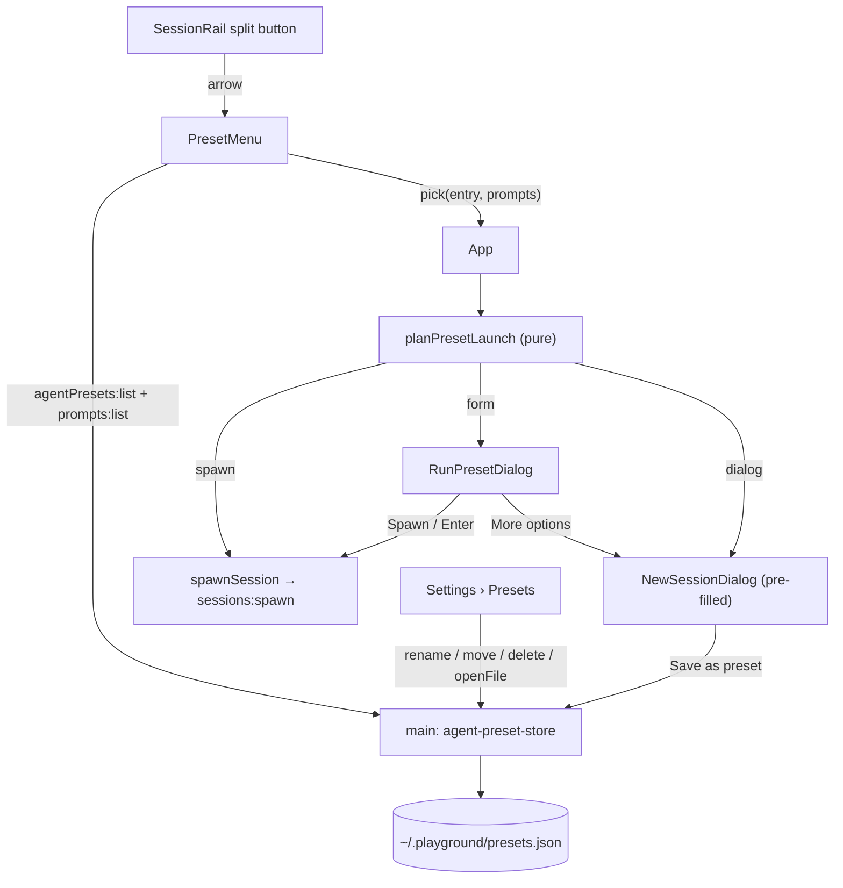

# Agent Presets Design

**Spec**: `.specs/features/agent-presets/spec.md`
**Context**: `.specs/features/agent-presets/context.md`
**Status**: Draft

---

## Architecture Overview

Main owns the file and the renderer decides the launch (owner's choice, 2026-10-14).

- **Main** owns `~/.playground/presets.json`. A new `agent-preset-store` module parses and
  validates it, checks that each preset's folder exists, and applies every change by reading the
  file again, applying the change to what it read, and writing atomically. The renderer reaches it
  only through `agentPresets:*` channels (AD-024: the renderer never reads the filesystem).
- **The renderer** decides what a pick does with one pure function, `planPresetLaunch`. Its inputs
  are the preset, the registry agents, the prompt listing, the tree and the pinned tasks, all
  things the renderer already holds or already fetches. Its output is one of three things: spawn
  now, show the Run preset form, or open New Session pre-filled. It reuses `prompt-form.ts`, so
  the pre-filled values are the ones the New Session dialog would show (PRST-23). Every spawn goes
  through the existing `spawnSession` (`use-sessions.ts:82`), which already selects the new
  session (PRST-27, PRST-28).



---

## Code Reuse Analysis

### Existing Components to Leverage

| Component | Location | How to Use |
| --------- | -------- | ---------- |
| `promptContext`, `prefillValues`, `formBlockers`, `resolveForm` | `src/renderer/src/lib/prompt-form.ts:25,59,75,87` | Starting values (PRST-23), the empty and too-long checks (PRST-21/22/24), the resolved text (APR-37). |
| `parsePlaceholders`, `PROMPT_MAX_CHARS`, `PromptEntry` | `src/shared/prompt-template.ts:14,23` | Placeholder names in parse order (PRST-22); a prompt that is `found` or `broken` (PRST-31). |
| `isolationLevelOf`, `samePath` | `src/renderer/src/lib/isolation-level.ts:28,38` | Map a preset's cwd to its level and tree path with AD-050's rule. |
| `levelOptions` | `src/renderer/src/lib/session-levels.ts:30` | The `LevelOption` that `promptContext` needs for the cwd. |
| `spawnSession` | `src/renderer/src/lib/use-sessions.ts:82` | The one spawn path: it invokes `sessions:spawn`, then selects the session and switches to Agents. |
| `handle` / contract map | `src/main/ipc.ts:17`, `src/shared/ipc-contract.ts` | New `agentPresets:*` channels, declared the same way as `prompts:*` (`:218`). |
| `listPrompts` (the injected-`fs` pattern) | `src/main/prompt-library.ts:17,26` | Shape of the store's `PresetFs` seam, which tests use to inject faults. |
| Temp-file + rename write | `src/main/config-store.ts:65` | Copied as an **async** atomic write. Its read path, which renames a bad file to `.bak-<ts>` (`:33-50`), is **not** copied (PRST-08). |
| Outside-click + Escape popover | `src/renderer/src/components/SyncPopover.tsx:74` | Closing rules for the anchored preset menu. |
| Rail context-menu styling | `SessionRail.tsx:197`, `.rail-ctx-menu` / `.rail-ctx-item` | Visual base for menu rows (`role="menu"` / `menuitem`). |
| Settings agent row look | `design/handoff/DESIGN_HANDOFF_AGENTS.md` §Dialog: Settings | Look of the Presets tab rows: bordered row, name 13.5px/700, mono sub line, 30×30 icon buttons. |
| Async-`rm` temp-dir tests | `src/main/prompt-library.test.ts:1-14` | Store tests (memory: `rmSync` no-ops on the non-ASCII profile path). |

### Integration Points

| System | Integration Method |
| ------ | ------------------ |
| Main IPC | Six new channels: `agentPresets:list`, `:save`, `:rename`, `:move`, `:delete`, `:openFile`. |
| `NewSessionSource` | Gains `agentName?` and `promptName?`, so More options (PRST-26) and a broken preset (PRST-33) can open the dialog pre-filled. Today it starts on `agents[0]` and None (`NewSessionDialog.tsx:108,125`). |
| `SettingsDialog` | Gains an `initialTab?` prop (PRST-37) and a `'presets'` tab. |
| `SessionRail` | `+ New session` becomes a split button; new props `agents`, `onPickPreset`, `onManagePresets`. |
| Smoke | New `scripts/smoke-agent-presets.mjs`. Main reads `PLAYGROUND_PRESETS_FILE` to override the file path, so the smoke never touches the real `~/.playground/presets.json`. |

---

## Components

### `agent-preset-store` (main)

- **Purpose**: Read, validate and change `presets.json` without ever losing a hand edit.
- **Location**: `src/main/agent-preset-store.ts` (+ `.test.ts`)
- **Interfaces**:
  - `parsePresetsText(text: string): ParsedPresets`: pure. It returns `{ ok: false, reason }` for
    `invalid JSON: <msg>` or `not an array` (PRST-03). Otherwise it returns `{ ok: true, raw }`,
    with `raw` being the parsed array exactly as read.
  - `classifyEntries(raw: unknown[]): ClassifiedEntry[]`: pure. In array order, each element is
    either `{ kind: 'ok', preset }` or `{ kind: 'invalid', name, reason }`. The reasons are
    `invalid entry: <field>` (PRST-04, checking `name`, `agent`, `cwd` and then `prompt`) and
    `duplicate name` (PRST-05: the first case-insensitive trimmed match wins).
  - `applyPresetOp(raw: unknown[], op: PresetOp): { raw: unknown[] } | { error: PresetOpError }`:
    pure. It finds its target by name (case-insensitive, valid entries only), never by index,
    because the file may have changed since the renderer listed it (PRST-09).
    - `save` appends `{ name, agent, cwd, prompt? }`. If the name exists and `replace` is not set,
      it returns `{ error: { kind: 'exists', name } }`. With `replace`, it spreads the old entry
      and overwrites `name`, `agent` and `cwd`, then sets or deletes `prompt`, at the same index
      (PRST-13, PRST-16, PRST-07).
    - `rename` spreads the entry and sets `name` (PRST-38, PRST-07). It returns `exists` when
      another entry already uses the new name (PRST-39).
    - `move` swaps the entry with its raw neighbour; at either end it returns an error (PRST-40).
    - `delete` splices the entry out (PRST-41).
    - Every op re-checks the name with `presetNameProblem` (shared).
  - `serializePresets(raw: unknown[]): string`: `JSON.stringify(raw, null, 2) + '\n'` (PRST-06).
  - `createPresetStore(file: string, fs: PresetFs = NODE_FS): PresetStore` holds the I/O:
    - `list(): Promise<AgentPresetListing>` reads the file. A missing file gives
      `{ ok: true, entries: [] }` (PRST-02). It then classifies the entries and stats each valid
      preset's cwd, so `cwdExists` is `true` only for a directory.
    - `change(op): Promise<AgentPresetChangeResult>` takes one turn on a per-store promise chain.
      It re-reads the file and refuses if the file is invalid (PRST-08's text). It then applies the
      op, writes `<file>.tmp`, renames it over the file (creating the folder first), and returns
      the new listing.
    - `openFile(): Promise<string | null>` writes `[]\n` if the file is missing, then
      `shell.openPath` through an injected opener. It returns the opener's error string, or `null`
      (PRST-42).
- **Dependencies**: `node:fs/promises`, `shell.openPath` (injected).
- **Reuses**: the `PromptFs` seam pattern and the temp-file + rename write.

### `agentPresets:*` channels (main wiring)

- **Purpose**: Expose the store.
- **Location**: `src/main/index.ts`, next to `prompts:*` (`:935`); contract in `src/shared/ipc-contract.ts`.
- **Interfaces**:
  - `'agentPresets:list': { req: void; res: AgentPresetListing }`
  - `'agentPresets:save': { req: { preset: AgentPreset; replace: boolean }; res: AgentPresetChangeResult }`
  - `'agentPresets:rename': { req: { from: string; to: string }; res: AgentPresetChangeResult }`
  - `'agentPresets:move': { req: { name: string; direction: 'up' | 'down' }; res: AgentPresetChangeResult }`
  - `'agentPresets:delete': { req: { name: string }; res: AgentPresetChangeResult }`
  - `'agentPresets:openFile': { req: void; res: { error: string | null } }`
- **File path**: `process.env.PLAYGROUND_PRESETS_FILE ?? join(homedir(), '.playground', 'presets.json')`.

### `preset-launch` (renderer, pure)

- **Purpose**: Turn a picked preset into exactly one action.
- **Location**: `src/renderer/src/lib/preset-launch.ts` (+ `.test.ts`)
- **Interfaces**:
  - `presetProblem(p: AgentPreset, cwdExists: boolean, agents: AgentDef[], prompts: PromptEntry[]): PresetProblem | null`.
    It checks in PRST-31's order and returns `'agent not found' | 'folder not found' | 'prompt not found' | 'prompt broken'`.
  - `planPresetLaunch(input: { preset; cwdExists; agents; prompts; tree; tasks }): PresetLaunchPlan`, where:
    - `{ kind: 'dialog', source: NewSessionSource }`: a problem was found (PRST-33). The source
      carries each of `agentName`, `cwd` and `promptName` that is still valid. The cwd is mapped to
      the tree's own spelling with `samePath`.
    - `{ kind: 'spawn', agentName, cwd, prompt?, task? }`: there is no prompt, or every
      placeholder's starting value is non-empty and the resolved text is ≤ 8000 characters
      (PRST-21).
    - `{ kind: 'form', agentName, cwd, promptName, template, names, values }`: otherwise
      (PRST-22). The starting values come from
      `prefillValues(names, promptContext(null, optionFor(cwd), cwd, tasks))` (PRST-23).
  - `presetTaskLink(names: string[], values: Record<string,string>, tasks: PinnedTaskView[]): SessionTask | undefined`.
    It applies PRST-29 and PRST-30: `taskId` must be in `names`, and its trimmed value must match
    `/^[1-9][0-9]*$/`. The title is the pinned task's `details.title`, else `null`.
- **Reuses**: `prompt-form.ts`, `parsePlaceholders`, `isolationLevelOf`, `levelOptions`, `samePath`.

### `presetNameProblem` (shared, pure)

- **Purpose**: One name rule for the dialog, Settings and main (PRST-15).
- **Location**: `src/shared/agent-presets.ts`, together with the types below.
- **Interfaces**: `presetNameProblem(name: string): string | null` returns
  `'1–40 characters, one line'` when the trimmed name is empty, longer than 40, or contains `\r`
  or `\n`, and `null` otherwise. `sameName(a, b)` compares trimmed names case-insensitively.

### `PresetMenu` (renderer)

- **Purpose**: The arrow half of the split button and its menu (PRST-18..20, PRST-32, PRST-34, PRST-35).
- **Location**: `src/renderer/src/components/PresetMenu.tsx` + `.css`
- **Interfaces**: props `{ agents: AgentDef[]; onPick(entry, prompts): void; onManage(): void; onClose(): void }`.
  - On mount it invokes `agentPresets:list` and `prompts:list` together. Until both answer it
    shows `Loading…`.
  - Rows show the name. A broken row adds the `alert` icon (`--amber`) and its reason in faint
    text. An entry-invalid row is disabled (PRST-34).
  - It closes on an outside click or Escape (SyncPopover pattern), and Escape does not reach the
    rail.
- **Reuses**: `.rail-ctx-menu` styling and the `Icon` set (`chevron-down`, `alert`, `settings`).

### `RunPresetDialog` (renderer)

- **Purpose**: Ask only for the empty placeholders (PRST-22, PRST-24..26).
- **Location**: `src/renderer/src/components/RunPresetDialog.tsx`
- **Interfaces**: props `{ plan: FormPlan; tasks; onSpawn(prompt, task?): void; onMoreOptions(): void; onClose(): void }`.
  - It reuses the variables-step markup and CSS (`ns-var-label`, `dialog-path-preview`,
    `ns-prompt-preview`), with the kicker `Preset` and the preset name as the title.
  - The fields sit inside a `<form>`, so Enter submits, and only while Spawn is enabled (PRST-25).
- **Reuses**: `resolveForm`, `formBlockers`, `NewSessionDialog.css`.

### `NewSessionDialog` changes

- `NewSessionSource` gains `agentName?` and `promptName?`, which seed the initial agent and prompt.
  An `agentName` missing from the registry falls back to `agents[0]`, and an unknown or broken
  prompt falls back to None.
- Footer, step 1: a ghost **Save as preset** button sits on the left, shown only when PRST-10/11
  allow it. Clicking it swaps the footer for an inline row: a name input, **Save** and **Cancel**.
  An `exists` answer turns the row into `Replace preset "<name>"?` with **Replace** and **Cancel**
  (PRST-16). Success shows `Saved preset "<name>"` and restores the footer (PRST-13). Failure keeps
  the row open and shows the reason (PRST-17).

### `SettingsDialog` changes

- A `'presets'` tab labelled **Presets**. A new `PresetsSettings.tsx` component holds its body to
  keep `SettingsDialog.tsx` small.
- Each row shows the name and, in the mono sub line, `<agent> · <cwd> · <prompt | No prompt>`, or
  `⚠ <reason>`. Its buttons are **Rename** (pencil, inline input), **Move up** / **Move down**
  (`chevron-down`, rotated for up) and **Delete** (trash, with an inline confirm).
- A header action reads **Open presets file**.
- Every action calls its channel and re-renders from the listing it returns (PRST-44).
- `initialTab?: SettingsTab` overrides the `'general'` default (`SettingsDialog.tsx:91`) for
  PRST-37 only.

### `SessionRail` + `App` wiring

- **Split button**: the existing `.session-rail-new` keeps its full-width look, minus a 34px
  segment on the right that holds `chevron-down`, separated by a 1px `var(--border)` line. The
  segment has `aria-haspopup="menu"`, `aria-expanded` and `aria-label="Agent presets"`. The empty
  state's `agents-empty-new` button is unchanged.
- **App**:
  - `onPickPreset(entry, prompts)` runs `planPresetLaunch` with `tree` and `tasks.tasks`. Then
    `spawn` calls `spawnSession`, `form` sets `runPreset` state, and `dialog` calls
    `openNewSession(source)`.
  - `onManagePresets` opens Settings on `'presets'`.

---

## Data Models

```typescript
// src/shared/agent-presets.ts
export interface AgentPreset {
  name: string
  agent: string // registry agent name
  cwd: string // absolute folder
  prompt?: string // prompt file name without .md; absent = None
}

export type AgentPresetEntry =
  | { kind: 'ok'; preset: AgentPreset; cwdExists: boolean }
  | { kind: 'invalid'; name: string | null; reason: string } // PRST-04 / PRST-05

export type AgentPresetListing =
  | { ok: true; entries: AgentPresetEntry[] } // file order (PRST-01)
  | { ok: false; reason: string } // PRST-03

export type AgentPresetChangeResult =
  | { ok: true; listing: AgentPresetListing }
  | { ok: false; error: { kind: 'exists'; name: string } | { kind: 'failed'; message: string } }

export type PresetOp =
  | { kind: 'save'; preset: AgentPreset; replace: boolean }
  | { kind: 'rename'; from: string; to: string }
  | { kind: 'move'; name: string; direction: 'up' | 'down' }
  | { kind: 'delete'; name: string }
```

**Relationships**: `agent` refers to `AppConfig.agents[].name`, and `prompt` refers to a
`PromptEntry.name`. Both links are resolved at pick time and never rewritten, so renaming an agent
breaks its presets visibly (spec Edge Cases). Nothing is stored in `config.json`.

---

## Error Handling Strategy

| Error Scenario | Handling | User Impact |
| -------------- | -------- | ----------- |
| File missing | `list` → empty; first `save` creates folder + file | Menu: "No presets yet…" (PRST-20) |
| File unparseable / not an array | `list` → `{ ok: false, reason }`; every `change` refused, file untouched | Menu row `presets.json: <reason>`; Settings shows reason + Open presets file (PRST-35, PRST-43) |
| Invalid / duplicate entry | Classified `invalid`; others unaffected | Disabled row with reason (PRST-34) |
| Agent / folder / prompt gone | `presetProblem` | Warning row; pick opens New Session pre-filled (PRST-33) |
| Name taken on save | `exists` → inline Replace confirm | One extra click (PRST-16) |
| Name taken on rename | `exists` | Inline `A preset named "<name>" already exists` (PRST-39) |
| Target gone between list and change (hand edit) | Op returns `failed: preset "<name>" not found`; listing re-fetched | Inline message; list refreshes |
| I/O error on write | Temp file not renamed; `failed: <message>` | Inline reason, name kept (PRST-17) |
| `shell.openPath` error | Returned string | Inline reason under Open presets file |
| Spawn fails | Existing `spawnSession` toast | Unchanged (Edge Cases) |

---

## Risks & Concerns

| Concern | Location (file:line) | Impact | Mitigation |
| ------- | -------------------- | ------ | ---------- |
| The dialog matches a cwd to its chip with `===`, not `samePath`. | `NewSessionDialog.tsx:152,170` | A hand-edited cwd spelled differently from the tree would open as "detached" with no branch context. | `planPresetLaunch` maps the cwd to the tree's own spelling before building a spawn, a form or a dialog source. |
| `config-store` renames an unparseable file to `.bak-<ts>`. | `src/main/config-store.ts:33-50` | Copying that pattern would move the developer's half-edited file away. | The store never renames or backs up the file, and refuses writes while it is invalid (PRST-08). This is recorded as AD-063. |
| No renderer component tests (node-only vitest, no DOM). | `vitest.config.ts` | Menu, dialog and Settings ACs would rest on code reading alone. | All decisions live in pure modules (`preset-launch`, `agent-presets`, the store) with unit tests. UI ACs get `scripts/smoke-agent-presets.mjs` (CDP), isolated through `PLAYGROUND_PRESETS_FILE` and a temp prompts-free path. |
| Settings always opens on General. | `SettingsDialog.tsx:91` | PRST-37 can't be met without a change. | `initialTab?` prop; NOTF-28's default stays for every other opener. |
| Two writes racing inside main (e.g. a double-clicked Move). | the store | Lost update. | A per-store promise chain serializes `change`, and each change re-reads the file. |
| Nothing locks the file against the developer's editor. | `presets.json` | An editor saving at the same millisecond could overwrite an app write, or the reverse. | This is accepted: the window is one write, and PRST-09's re-read covers every edit saved before it. |
| The name `Preset` collides with the workflows' `PermissionPreset`. | `src/shared/workflows.ts:20` | Confusing imports. | Every new symbol and channel uses the `AgentPreset` / `agentPresets:` prefix. |

---

## Tech Decisions

| Decision | Choice | Rationale |
| -------- | ------ | --------- |
| Op targeting | By name (case-insensitive), not index | The file can change by hand between list and change (PRST-09). |
| Folder existence | Checked in main during `list` (`cwdExists`) | AD-024; one stat per preset per menu open. |
| Placeholder starting values | Exactly `prefillValues(promptContext(null, option, cwd, tasks))` | PRST-23 says "as New Session would"; sharing the function makes it so by construction. |
| `{{taskId}}` link | Decided on the final values (pre-filled or typed) | One rule whether the id came from the branch or the keyboard. |
| File path override | `PLAYGROUND_PRESETS_FILE` env var | Lets the smoke run without touching the real profile; no UI. |
| Async atomic write | `writeFile(tmp)` + `rename` via `fs/promises` | Main stays responsive; the same crash safety as `config-store`. |

> **Project-level decision recorded:** AD-063 in `.specs/STATE.md`.
