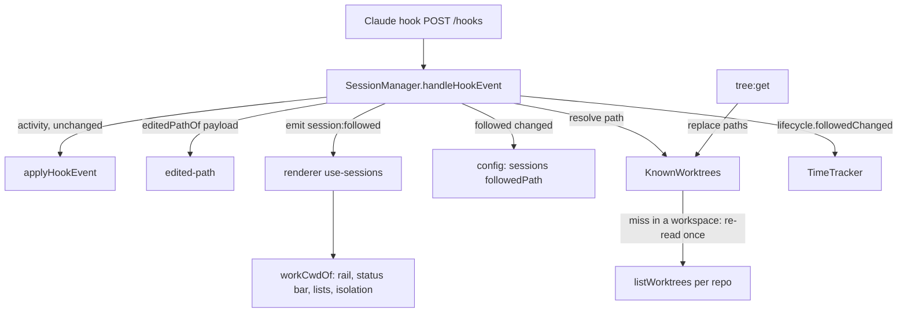

# Session Follows the Worktree It Edits Design

**Spec**: `.specs/features/session-follows-worktree/spec.md`
**Status**: Approved

---

## Architecture Overview

Approach A (owner choice): main keeps the worktree paths from every tree build and
matches an edited path against them in memory; a miss inside a registered workspace
re-reads that workspace's worktrees once. Main owns the decision, the persisted
field and the time tracker update; the renderer only reads one more field.

A session gains `followedPath`, kept apart from the launch `cwd`. Everything that
places a session (rail, status bar, worktree lists, hours, notification branch)
reads `workCwdOf(session) = followedPath ?? cwd`. Everything that runs the
terminal (PTY, respawn, duplicate, title, "Respawn in") keeps `cwd`.



---

## Code Reuse Analysis

### Existing Components to Leverage

| Component | Location | How to Use |
| --------- | -------- | ---------- |
| Deepest-match rule (AD-037) | `src/renderer/src/lib/tree-selection.ts` `worktreeIdForPath` | Same rule (case-insensitive, separator-agnostic, deepest wins) reimplemented over a flat path list in `src/shared`, so main can use it; the renderer helper stays as is |
| Task change in the tracker | `src/main/time-tracker.ts` `taskChanged` | `followedChanged` copies its shape: close the open period at now, open the next at the same instant |
| Lifecycle observer | `SessionLifecycle` in `session-manager.ts` | Add `followedChanged(id, path)` beside `taskChanged` |
| Task link event | `setTask` → `emit('session:task')`, `use-sessions.ts` | `session:followed` follows the same path end to end |
| Worktree listing | `listWorktrees` in `worktree-manager.ts` (via `git.ts`, AD-023) | The miss re-read lists each repo of the workspace |
| Tree build | `tree:get` in `index.ts` | Feeds `KnownWorktrees.replace` with every worktree path and workspace path |
| Hook payloads | `activity-machine.test.ts` fixtures | Shape of `tool_name` / `tool_input` for tests |

### Integration Points

| System | Integration Method |
| ------ | ------------------ |
| Config (`sessions[]`) | Optional `followedPath` on `PersistedSession`; absent = launch folder |
| IPC | New event `session:followed: { id; followedPath: string \| null }` |
| Worktree removal | After a removal, `SessionManager.clearFollowed(path)` drops the field from sessions that follow the removed worktree |
| Notifications | `ActivityChange.cwd` carries `workCwdOf(meta)` so the branch it names is the followed one |

---

## Components

### worktree-match (shared)

- **Purpose**: The deepest worktree path containing a target path.
- **Location**: `src/shared/worktree-match.ts`
- **Interfaces**:
  - `deepestContaining(worktreePaths: readonly string[], target: string): string | null` - case-insensitive, `\` and `/` equal, match only at a separator boundary, deepest wins; returns the worktree path as given
- **Dependencies**: none
- **Reuses**: AD-037's rule

### workCwdOf (shared)

- **Purpose**: The folder a session is attributed to.
- **Location**: `src/shared/config.ts` (beside `PersistedSession`)
- **Interfaces**:
  - `workCwdOf(session: Pick<PersistedSession, 'cwd' | 'followedPath'>): string`

### edited-path (main)

- **Purpose**: The file a hook payload says the agent is editing, or null.
- **Location**: `src/main/edited-path.ts`
- **Interfaces**:
  - `editedPathOf(payload: Record<string, unknown>): string | null` - only `PreToolUse` / `PostToolUse` with `tool_name` in `Edit`, `Write`, `MultiEdit`, `NotebookEdit`; reads `tool_input.file_path`, else `tool_input.notebook_path`; null unless a non-empty absolute string

### KnownWorktrees (main)

- **Purpose**: Resolve a path to a known worktree, re-reading a workspace once on a miss.
- **Location**: `src/main/known-worktrees.ts`
- **Interfaces**:
  - `replace(snapshot: { workspaces: string[]; worktrees: string[] }): void` - called on every tree build
  - `match(path: string): string | null` - synchronous, cache only
  - `resolve(path: string): Promise<string | null>` - `match`; on a miss inside a known workspace, one re-read (coalesced: a second miss while one is in flight awaits the same re-read), merge, match again; a failed re-read logs and returns null
- **Dependencies**: `reread(workspacePath: string): Promise<string[]>` injected (production: the workspace's repos through `listWorktrees`), `logError`
- **Reuses**: `deepestContaining`

### SessionManager (main, modified)

- **Purpose**: Apply the follow rule on edit events.
- **Interfaces**:
  - `handleHookEvent` - unchanged activity handling, then `void this.#follow(session, editedPathOf(payload))`
  - `#follow` - resolve; ignore when null, when equal to `match(meta.cwd)` (launch worktree), or when equal to the current `followedPath`; guards a stale answer by checking the session is still running; otherwise persist `followedPath`, emit `session:followed`, call `lifecycle.followedChanged`
  - `clearFollowed(worktreePath: string): void` - for every persisted session whose `followedPath` is that path: drop the field, persist, emit, call `followedChanged(id, null)`
  - `duplicate` - already builds a fresh meta without `followedPath` (SFWT-16)
  - `respawn` / `#start` - keep `followedPath`; `lifecycle.started(meta)` receives it
- **Dependencies**: new optional dep `worktrees?: Pick<KnownWorktrees, 'match' | 'resolve'>`; absent = feature off (tests of other behaviour unchanged)

### TimeTracker (main, modified)

- **Interfaces**:
  - `started(meta)` - the run's cwd is `meta.followedPath ?? meta.cwd` (SFWT-10)
  - `followedChanged(sessionId: string, path: string | null): void` - new run cwd is `path ?? launch cwd`; same cwd = no-op; counting run closes and reopens at one instant; paused/suspended run only keeps it (SFWT-08, SFWT-09)
- **Reuses**: `taskChanged`

### Renderer readers (modified)

- `use-sessions.ts` - handle `session:followed`: patch the session's `followedPath`
- `rail-groups.ts` - group and level by `workCwdOf(session)`
- `SessionRail.tsx` - level group totals and live flag by `workCwdOf`
- `status-bar.ts` - `worktreeContaining(tree, workCwdOf(session))`
- `isolation-level.ts` - session worktree id by `workCwdOf`
- `App.tsx` - worktree detail and Files session lists, running filter and turn-end recount by `workCwdOf`
- `AgentsView.tsx` - attribution by `workCwdOf`; the cwd label and "Respawn in" keep `session.cwd`

---

## Data Models

```typescript
export interface PersistedSession {
  // ...existing fields
  /** The worktree the agent last edited in, when it is not the launch folder's
   *  (SFWT-01). Attribution reads it; the PTY never does. Absent = launch folder. */
  followedPath?: string
}
```

```typescript
// ipc-contract events
'session:followed': { id: string; followedPath: string | null }
```

Time periods are unchanged: a period's `cwd` is the run's attributed folder, as it always was.

---

## Error Handling Strategy

| Error Scenario | Handling | User Impact |
| -------------- | -------- | ----------- |
| Re-read of a workspace fails | Logged; `resolve` returns null | Session stays where it is; next edit retries |
| Edit event for a stopped session | Ignored (no running session) | None |
| Resolve answers after the session stopped | Dropped by the running check | None |
| Followed worktree removed through the app | `clearFollowed` | Session returns to the launch folder |
| Followed worktree deleted outside the app | On load, `followedPath` that no longer exists is dropped (same check as `pathMissing`) | Session returns to the launch folder after restart; until then the rail shows it detached |
| Config write fails | Same handling as `setTask` (throws to the caller, logged) | None new |

---

## Risks & Concerns

| Concern | Location (file:line) | Impact | Mitigation |
| ------- | -------------------- | ------ | ---------- |
| Every edit runs through `handleHookEvent`, which is on the hot path of activity | `src/main/session-manager.ts:327` | Slower activity updates | `#follow` is fire-and-forget after the activity update; `match` is an in-memory scan; re-reads only on a miss inside a workspace and coalesced |
| Renderer readers compare `s.cwd === path` exactly, while AD-037 matches deepest | `src/renderer/src/App.tsx:572`, `:640` | A followed path spelled differently from the tree would not list | `followedPath` is stored as the worktree path the tree gave (`KnownWorktrees` returns it as given), so equality holds |
| Worktree removal stops sessions by `s.cwd === worktree.path` | `src/main/index.ts` (worktrees:remove) | Could be extended by mistake to followed sessions, killing a PTY in the launch folder | Removal stop logic unchanged; only `clearFollowed` is added |
| No test spans index.ts wiring | `src/main/index.ts` | Wiring gaps invisible to unit tests | Smoke task drives a real Claude session (memory: dev app runs real agents) and is falsified against a build without the wiring |
| L-005: real-process tests near the timeout | test suites | Flaky gate | All new tests are pure or use fakes; no real git |

---

## Tech Decisions

| Decision | Choice | Rationale |
| -------- | ------ | --------- |
| Field name | `followedPath` | Reads as "the worktree this session follows"; distinct from `cwd` |
| Matching home | `src/shared/worktree-match.ts` | Main needs it; keeping the renderer helper avoids touching AD-037 callers |
| Feature switch | Optional `worktrees` dep on `SessionManager` | Same pattern as `lifecycle`, `names`; tests that do not care stay untouched |
| Project-level decision | Record as next AD: "A session is attributed to `followedPath ?? cwd`; the PTY, respawn, duplicate and title use `cwd`" | Future features must read `workCwdOf` |
