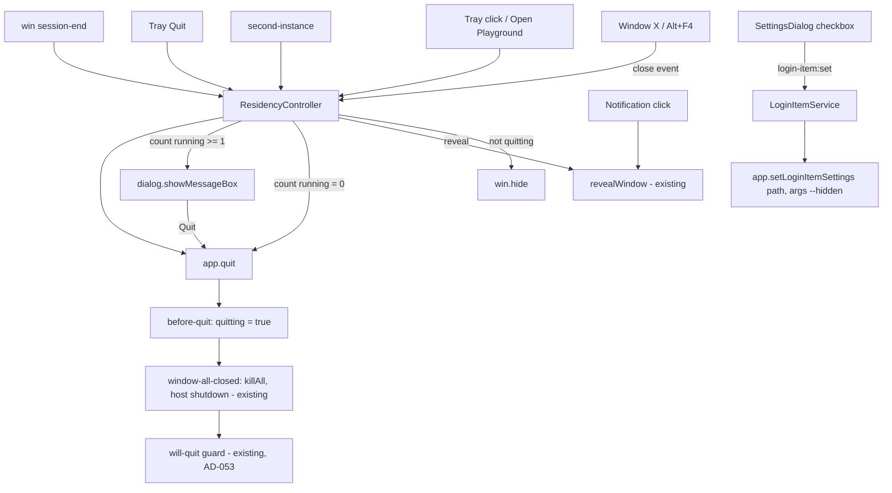

# Tray Residency Design

**Spec**: `.specs/features/tray-residency/spec.md`
**Status**: Draft

---

## Architecture Overview

All of it lives in main, beside the existing quit path. Two small modules hold the policy with injected
Electron ports, following `update-service.ts` and `unseen-badge.ts`, so it is unit-tested with fakes and
no Electron. `index.ts` only wires real Electron objects into them. The renderer gains one checkbox and
two IPC calls.



The quit path is unchanged after `app.quit()`: `before-quit` raises the `quitting` flag so the close
handler lets the window close, then `window-all-closed` and the `will-quit` guard run exactly as today.
That keeps TRAY-12 and TRAY-14 (`autoInstallOnAppQuit` hooks into the same quit) free.

---

## Code Reuse Analysis

### Existing Components to Leverage

| Component | Location | How to Use |
| --------- | -------- | ---------- |
| Quit path (killAll, PTY host shutdown, time tracker, hook server) | `src/main/index.ts:935` (`window-all-closed`), `:303` (`will-quit` guard) | Unchanged; reached through `app.quit()` |
| `revealWindow` | `src/main/index.ts:612` | Tray click, `Open Playground`, `second-instance` and the existing notification click all call it; it already does restore + show + focus |
| `windowFocused` | `src/main/index.ts:621` | Unchanged: a hidden window is not focused, so `SessionNotifier` raises the native notification (TRAY-03, TRAY-06) |
| `SessionManager.list()` | `src/main/session-manager.ts:181` | Running count for the quit dialog: `list().filter(s => s.status === 'running').length` |
| Injected-port pattern | `src/main/update-service.ts`, `src/main/unseen-badge.ts` | Shape of both new modules and their tests |
| App icon | `resources/icon.png` (256×256), imported in `index.ts:20` | Tray image, resized to 16×16 with `nativeImage` |
| Persist-on-change switches | `SettingsDialog.tsx:123-138` (`persistShell`, `persistNotify`) | Same pattern for the login checkbox (TRAY-22) |
| Typed IPC maps | `src/shared/ipc-contract.ts`, `src/main/ipc.ts` | Two new invoke channels |

### Integration Points

| System | Integration Method |
| ------ | ------------------ |
| Electron `app` | `requestSingleInstanceLock`, `second-instance`, `before-quit`, `getLoginItemSettings` / `setLoginItemSettings` |
| `BrowserWindow` | `close` (preventDefault + hide), `session-end` (Windows), `ready-to-show` gated by `--hidden` |
| `Tray`, `Menu`, `nativeImage`, `dialog` | Created in `whenReady`, handed to `ResidencyController` as ports |
| `electron-updater` | None: apply-on-quit already rides `app.quit()` |

---

## Components

### ResidencyController

- **Purpose**: Decide what close, quit, session-end and reveal requests do, given whether a quit is under way and how many sessions run.
- **Location**: `src/main/residency-controller.ts` (+ `.test.ts`)
- **Interfaces**:
  - `constructor(ports: ResidencyPorts)`
  - `onWindowClose(event: { preventDefault(): void }): void`: when not quitting, prevent and `hideWindow()` (TRAY-02); when quitting, let it through
  - `onBeforeQuit(): void`: sets `quitting = true` (any quit path, including the updater's)
  - `requestQuit(): Promise<void>`: 0 running → `quit()` (TRAY-10); else `confirmQuit(n)` → `true` → `quit()` (TRAY-11, TRAY-12), `false` → nothing (TRAY-13)
  - `onSessionEnd(): void`: `quitting = true`, `quit()` without asking (TRAY-15)
  - `reveal(): void`: `revealWindow()` (TRAY-04, TRAY-31)
  - `menuTemplate(): { label: 'Open Playground' | 'Quit'; click(): void }[]` (TRAY-05)
- **Dependencies**: `ResidencyPorts` = `{ hideWindow(): void; revealWindow(): void; runningCount(): number; confirmQuit(n: number): Promise<boolean>; quit(): void }`
- **Reuses**: the existing `revealWindow`; the quit path via `quit = () => app.quit()`
- **Notes**: a second `requestQuit` while a dialog is open is ignored (one dialog at a time). `confirmQuit` in `index.ts` is `dialog.showMessageBox` with message `${n} running session(s) will be stopped. Quit anyway?`, buttons `['Quit', 'Cancel']`, `defaultId: 1`, `cancelId: 1`, parented to no window, so it shows while the window is hidden.

### LoginItemService

- **Purpose**: Read and write the Windows login item that starts the app hidden.
- **Location**: `src/main/login-item.ts` (+ `.test.ts`)
- **Interfaces**:
  - `get(): LoginItemState`: `{ available: false, enabled: false }` when not packaged (TRAY-25); else `enabled` from the OS (TRAY-21)
  - `set(enabled: boolean): LoginItemResult`: not packaged → `{ ok: false, error: 'only in the installed app', state }` with no write; else write, read back, `ok` when the read-back matches, otherwise `error: 'Windows did not apply the change'`; a thrown error becomes its message (TRAY-22, TRAY-26)
- **Dependencies**: `LoginItemPort` = `{ isPackaged: boolean; execPath: string; getLoginItemSettings(o: { path: string; args: string[] }): { openAtLogin: boolean; executableWillLaunchAtLogin?: boolean }; setLoginItemSettings(o: { openAtLogin: boolean; path: string; args: string[] }): void }`
- **Reuses**: nothing; the args constant `HIDDEN_ARG = '--hidden'` is exported for `index.ts`
- **Notes**: `enabled` = `executableWillLaunchAtLogin ?? openAtLogin`, so an entry the owner disabled in Task Manager's Startup apps reads as off.

### Startup wiring (`index.ts`)

- **Purpose**: Single instance, hidden start, tray, and hooking the controller into window and app events.
- **Location**: `src/main/index.ts`
- **Changes**:
  - Before `whenReady`: `if (!app.requestSingleInstanceLock()) { app.quit(); return-early }`, so no window, PTY host or hook server is created (TRAY-30). `app.on('second-instance', () => residency.reveal())` (TRAY-31).
  - `const startHidden = process.argv.includes(HIDDEN_ARG)`; `ready-to-show` calls `win.show()` only when `!startHidden` (TRAY-23, TRAY-24, TRAY-32).
  - `win.on('close', e => residency.onWindowClose(e))`, `win.on('session-end', () => residency.onSessionEnd())`; `app.on('before-quit', () => residency.onBeforeQuit())`.
  - In `whenReady`: `tray = new Tray(nativeImage.createFromPath(icon).resize({ width: 16, height: 16 }))`, tooltip `Playground`, `tray.on('click', reveal)`, context menu from `menuTemplate()` (TRAY-01, TRAY-04, TRAY-05). On `will-quit`: `tray.destroy()` (TRAY-16).
  - `revealWindow` moves out of the `whenReady` closure to module scope so the controller and `second-instance` reach it.
- **Reuses**: everything in the quit path, untouched.

### Login item IPC + Settings checkbox

- **Purpose**: Expose `LoginItemService` to the General tab.
- **Location**: `src/shared/ipc-contract.ts`, `src/main/index.ts` (handlers), `src/renderer/src/components/SettingsDialog.tsx`
- **Interfaces**:
  - `'login-item:get': { req: void; res: LoginItemState }`
  - `'login-item:set': { req: { enabled: boolean }; res: LoginItemResult }`
- **UI**: in the General tab, after the default-shell control: checkbox `Start Playground when Windows starts`, note `· opens hidden in the tray`; disabled with note `· only in the installed app` when `available` is false; an error line `Couldn't change the startup setting: <error>` under it after a failed set, cleared on the next toggle. State loaded with `login-item:get` when the dialog opens, next to `config:get` (TRAY-20, TRAY-21, TRAY-25, TRAY-26).
- **Reuses**: the dialog's existing checkbox and note classes (`dialog-field-label`, `dialog-label-note`) and its persist-on-change pattern.

---

## Data Models

```typescript
// src/shared/login-item.ts (shared by main and renderer)
export interface LoginItemState {
  /** False outside the installed (packaged) app; the checkbox is disabled. */
  available: boolean
  /** The OS will start the app at login (Task Manager's Startup apps respected). */
  enabled: boolean
}

export type LoginItemResult =
  | { ok: true; state: LoginItemState }
  | { ok: false; error: string; state: LoginItemState }
```

No `config.json` change: the OS login item is the only store (spec assumption).

---

## Error Handling Strategy

| Error Scenario | Handling | User Impact |
| -------------- | -------- | ----------- |
| Login item write throws or does not stick | `set` returns `ok: false` with the read-back state | Checkbox snaps back; inline error line (TRAY-26) |
| Not packaged | `get` → `available: false`; `set` never writes | Checkbox disabled, note shown (TRAY-25) |
| Second process starts | Lock not acquired → `app.quit()` before any init | Existing window comes forward (TRAY-30, TRAY-31) |
| Quit requested twice while the dialog is open | Second request ignored | One dialog |
| Windows logoff while the window is hidden | `session-end` → quit without dialog | Sessions stop, as they do today on logoff |
| Notification clicked after the window was destroyed (quit under way) | Existing `revealWindow` guard (NOTF-21) | Nothing happens |

---

## Risks & Concerns

| Concern | Location (file:line) | Impact | Mitigation |
| ------- | -------------------- | ------ | ---------- |
| `window-all-closed` stops being the quit trigger for the X; anything that relied on "close = quit" changes | `src/main/index.ts:935` | A path that closes the window expecting a quit would now just hide it | Only the X and Alt+F4 hit `close`; `app.quit()` paths set `quitting` in `before-quit` first, so `window-all-closed` still runs on every real quit. Covered by a controller test (close while quitting is not prevented) |
| `session-end` is the only Windows logoff hook; if Windows force-kills before it fires, the `will-quit` guard does not run | `src/main/index.ts:303` | Orphaned `pwsh`/`claude` processes after logoff | The PTY host is a child of the app and ConPTY children die with their console; verify by hand in UAT (logoff with a running session, check Task Manager after login) |
| `setLoginItemSettings` returns no error on Windows; failure is only visible on read-back | Electron API | A silent no-op would show the box checked | `set` always reads back and compares (TRAY-26) |
| Tray image from a 256×256 PNG may look soft at 16 px on high DPI | `resources/icon.png` | Cosmetic | Accepted for this feature; an `.ico` with 16/32 px frames is a follow-up if it looks bad |
| `index.ts` wiring has no unit tests | `src/main/index.ts` | Close/tray/lock wiring regressions go unnoticed | Policy lives in the two tested modules; a CDP smoke (`scripts/smoke-tray-residency.mjs`) closes the window and asserts the process and a session survive, then quits through the controller |
| The renderer stays alive while hidden | `src/main/index.ts:230` | Memory held while hidden | Accepted (spec assumption); the attached terminal keeps its state |

---

## Tech Decisions (only non-obvious ones)

| Decision | Choice | Rationale |
| -------- | ------ | --------- |
| Where the quit-vs-hide flag lives | `before-quit` sets it in the controller | Electron's documented order (`before-quit` → window `close`) makes every `app.quit()` caller, the updater included, pass through without knowing about the tray |
| Lock placement | Top level, before `whenReady` | TRAY-30: nothing is created by a losing instance |
| Login state source | `executableWillLaunchAtLogin ?? openAtLogin` | Respects the Task Manager Startup toggle |
| Dialog parent | None | A dialog parented to a hidden window would not show |

No new project-level decision: AD-067 already records the architecture.
